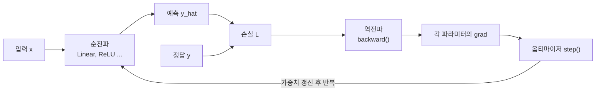
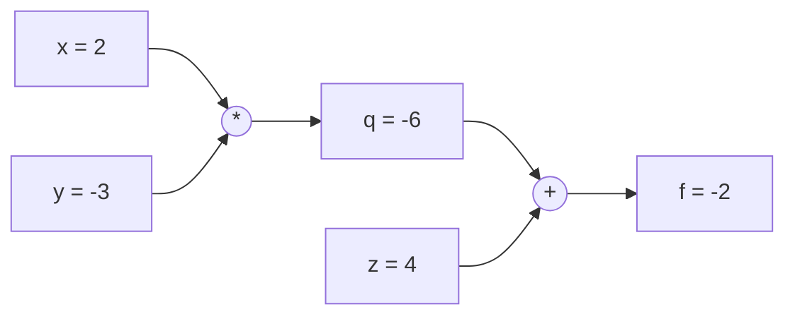
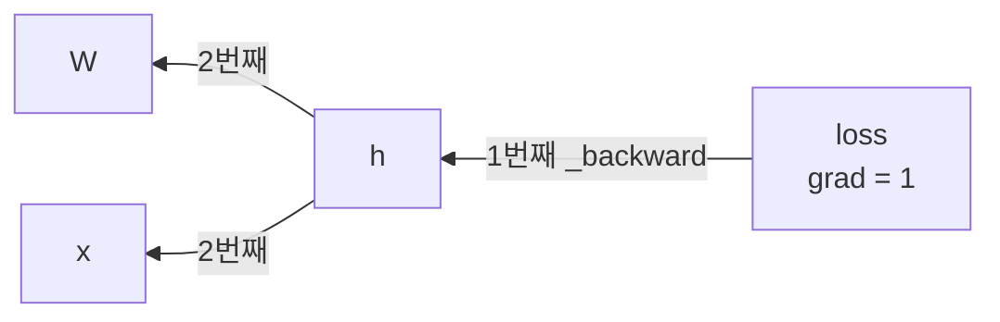

# A6-1 개념 정리 — NumPy로 만드는 자동 미분 엔진, 기울기 검증, 가중치 초기화

이 문서는 A6-1 과제를 혼자 수행하는 데 필요한 개념을 처음부터 설명합니다. 코드 정답은 담지 않았습니다. 대신 "왜 이렇게 만들어야 하는지"와 "손으로 계산하면 어떤 값이 나오는지"를 보여 주어, 직접 구현한 코드가 맞는지 스스로 판단할 수 있게 하는 것이 목표입니다.

- 과제 원문과 요구사항: [../subject.md](../subject.md)
- 실제 작업 순서와 체크포인트: [WALKTHROUGH.md](WALKTHROUGH.md)

과제의 흐름은 **구현 → 검증 → 실험** 세 단계입니다. 이 문서도 같은 순서로 개념을 쌓습니다.

## 읽는 순서

| 순서 | 배울 내용 | 이걸 알면 할 수 있는 일 |
| --- | --- | --- |
| 1 | 딥러닝 학습 루프의 큰 그림 | 순전파, 손실, 역전파, 업데이트가 각각 어느 모듈의 일인지 나누기 |
| 2 | NumPy 배열, shape, 브로드캐스팅 | 연산 결과의 shape를 미리 예측하고 오류 메시지 읽기 |
| 3 | 미분과 연쇄 법칙 | 합성 함수의 기울기를 손으로 구하기 |
| 4 | 계산 그래프와 자동 미분 | `Tensor`의 `data`, `grad`, `_backward`와 `backward()` 설계하기 |
| 5 | 연산별 역전파 공식 | `+`, `-`, `*`, `/`, MatMul의 역전파 작성, 브로드캐스팅 기울기 처리 |
| 6 | 레이어와 손실 함수 | Linear, ReLU, Sigmoid, Softmax, 교차 엔트로피 구현 |
| 7 | 수치 미분과 Gradient Checking | `gradient_check.py`로 상대 오차 1e-7 이하 증명하기 |
| 8 | 가중치 초기화 | Zero/Random/He/Xavier 구현, 대칭성 문제와 기울기 소실/폭주 설명하기 |
| 9 | 옵티마이저 | SGD와 Adam의 업데이트 식 구현하기 |
| 10 | 데이터와 학습 검증 | XOR, MNIST 바이너리 직접 파싱, 미니배치 로더 직접 만들기 |
| 11 | 실험 설계와 그래프 해석 | 초기화 비교 실험을 공정하게 설계하고 결론 쓰기 |
| 12 | 보너스 개념 | Dropout, L2 정규화, Tanh/LeakyReLU/ELU의 미분 |

1~5를 이해하면 엔진을 만들 수 있고, 7을 이해하면 엔진이 맞다는 것을 증명할 수 있으며, 8~11을 이해하면 실험 리포트를 쓸 수 있습니다.

## 1. 딥러닝 학습 루프의 큰 그림

### 비유: 과녁 맞히기

눈을 가리고 다트를 던진다고 생각해 봅니다. 던지고(순전파), 친구가 "왼쪽으로 3cm 빗나갔어"라고 알려 주고(손실), 팔의 각도와 힘 중 무엇을 얼마나 고쳐야 하는지 따져 보고(역전파), 실제로 자세를 조금 고칩니다(업데이트). 이 과정을 수백 번 반복하는 것이 학습입니다.

### 정확한 정의

| 단계 | 하는 일 | 과제에서 담당하는 모듈 |
| --- | --- | --- |
| 순전파 (forward) | 입력 $x$와 가중치 $W$로 예측 $\hat{y}$를 계산 | `Tensor` 연산, 레이어 |
| 손실 (loss) | 예측과 정답의 차이를 숫자 하나 $L$로 요약 | 손실 함수 (Softmax + 교차 엔트로피 등) |
| 역전파 (backward) | 모든 가중치에 대해 $\partial L / \partial W$ 계산 | autograd (`backward()`) |
| 업데이트 (step) | $W \leftarrow W - \eta \cdot \partial L/\partial W$ | 옵티마이저 (SGD, Adam) |



과제의 README 템플릿에 나오는 `core / nn / optim` 구분은 이 표와 거의 같습니다. `core`는 `Tensor`와 자동 미분, `nn`은 레이어와 초기화, `optim`은 옵티마이저입니다.

### 흔한 오해

- "역전파가 가중치를 바꾼다" — 아닙니다. 역전파는 **기울기를 계산만** 합니다. 가중치를 실제로 바꾸는 것은 옵티마이저입니다.
- "PyTorch를 쓰면 되지 않나" — 이 과제는 PyTorch, TensorFlow를 로직 참고용으로만 볼 수 있고, 구현은 NumPy만 사용해야 합니다([../subject.md](../subject.md) 7장).

## 2. NumPy 배열, shape, 브로드캐스팅

### shape 읽기

딥러닝 코드 오류의 절반은 shape 오류입니다. 이 과제에서 자주 쓰는 shape는 다음과 같습니다.

| 이름 | shape | 의미 |
| --- | --- | --- |
| 입력 배치 `X` | `(N, D)` | 샘플 N개, 각 샘플의 특성 D개 (MNIST라면 D=784) |
| 가중치 `W` | `(D, H)` | 입력 D개를 출력 H개로 연결 |
| 편향 `b` | `(H,)` | 출력 뉴런마다 하나 |
| 출력 `X @ W + b` | `(N, H)` | 샘플마다 H개의 값 |

### 브로드캐스팅

**비유:** 반 학생 30명의 시험 점수 표(30×3과목)에 "과목별 보너스 점수"(3개)를 더하는 상황입니다. 보너스 3개를 30줄로 복사해서 더하는 것과 같은데, NumPy는 실제로 복사하지 않고 "복사한 것처럼" 계산해 줍니다. 이것이 브로드캐스팅입니다.

**규칙:** 두 배열의 shape를 오른쪽 끝부터 비교해서, 각 축의 크기가 같거나 한쪽이 1이면 연산할 수 있습니다. 축 개수가 적은 쪽은 왼쪽에 크기 1인 축이 있다고 간주합니다.

| A shape | B shape | 결과 shape | 설명 |
| --- | --- | --- | --- |
| `(4, 3)` | `(3,)` | `(4, 3)` | B가 `(1, 3)`으로 간주되어 4번 반복 |
| `(4, 3)` | `(4, 1)` | `(4, 3)` | B가 열 방향으로 3번 반복 |
| `(4, 3)` | `(4,)` | 오류 | 오른쪽 끝 3과 4가 다름 |

### 브로드캐스팅이 기울기에 미치는 영향 (과제 목표 항목)

순전파에서 값이 **복사되어 여러 번 쓰였다면**, 역전파에서는 그 값의 기울기를 **모두 더해야** 합니다. 한 사람이 여러 프로젝트에 참여했다면 그 사람의 기여도는 각 프로젝트 기여도의 합인 것과 같습니다.

손 계산 예시입니다. `X`의 shape가 `(2, 3)`, `b`가 `(3,)`이고 `out = X + b`, 손실이 `L = out.sum()`이라고 합니다.

- $\partial L / \partial \text{out}$는 모든 원소가 1인 `(2, 3)` 배열입니다.
- `b`의 각 원소는 2개의 행에 복사되어 쓰였습니다.
- 따라서 $\partial L / \partial b = [1+1,\ 1+1,\ 1+1] = [2, 2, 2]$이고 shape는 `(3,)`이어야 합니다.

즉 상위에서 내려온 기울기를 **브로드캐스팅으로 늘어난 축 방향으로 `sum`해서 원래 shape로 되돌려야** 합니다. 이 처리를 흔히 unbroadcast라고 부릅니다. 규칙은 두 가지입니다.

1. 기울기의 축 개수가 원래보다 많으면, 앞쪽의 남는 축을 `sum`으로 없앱니다.
2. 원래 shape에서 크기가 1이었던 축은 `sum(axis=..., keepdims=True)`로 줄입니다.

### 흔한 오해

- "`grad`의 shape는 대충 맞으면 된다" — `grad`의 shape는 반드시 `data`의 shape와 같아야 합니다. 다르면 옵티마이저에서 `W -= lr * grad`가 또 브로드캐스팅되어 조용히 틀린 값이 들어갑니다. 오류가 나지 않아서 더 위험합니다.
- "`(N,)`과 `(N, 1)`은 같다" — 다릅니다. `(N,)` 와 `(N, 1)`을 빼면 `(N, N)`이 됩니다. 손실 계산에서 자주 터지는 버그입니다.

## 3. 미분과 연쇄 법칙

### 미분의 직관

미분 $f'(x)$는 "$x$를 아주 조금 바꿨을 때 $f$가 몇 배만큼 바뀌는가"입니다. 자동차 계기판의 속도처럼 **그 순간의 변화율**입니다.

$$f'(x) = \lim_{h \to 0} \frac{f(x+h) - f(x)}{h}$$

여러 변수 함수에서는 변수마다 따로 미분한 **편미분** $\partial f / \partial x$를 씁니다. 다른 변수는 상수로 고정하고 하나만 움직였을 때의 변화율입니다.

### 연쇄 법칙 (Chain Rule)

**비유:** 환율 계산입니다. 1달러가 1,300원이고 1원이 0.11엔이면, 1달러는 $1300 \times 0.11 = 143$엔입니다. 단계별 변화율을 **곱하면** 전체 변화율이 됩니다.

$y = f(u)$, $u = g(x)$이면

$$\frac{dy}{dx} = \frac{dy}{du} \cdot \frac{du}{dx}$$

### 손 계산 예시

$f = (x \cdot y) + z$, $x = 2$, $y = -3$, $z = 4$라고 합니다. 중간값 $q = x \cdot y$를 두면 $f = q + z$입니다.

| 단계 | 계산 | 값 |
| --- | --- | --- |
| 순전파 | $q = 2 \times (-3)$ | $-6$ |
| 순전파 | $f = -6 + 4$ | $-2$ |
| 역전파 시작 | $\partial f / \partial f$ | $1$ |
| 덧셈 노드 | $\partial f/\partial q = 1$, $\partial f/\partial z = 1$ | $1$, $1$ |
| 곱셈 노드 | $\partial f/\partial x = \partial f/\partial q \cdot y$ | $1 \times (-3) = -3$ |
| 곱셈 노드 | $\partial f/\partial y = \partial f/\partial q \cdot x$ | $1 \times 2 = 2$ |

여기서 중요한 관찰은 두 가지입니다.

1. 각 노드는 **자기 연산의 국소 미분**(덧셈이면 1, 곱셈이면 상대방 값)만 알면 됩니다.
2. 위에서 내려온 기울기(upstream gradient)에 국소 미분을 **곱해서** 아래로 넘깁니다.

이것이 "연쇄 법칙이 코드 레벨에서 구현되는 방식"이며, 과제 목표 중 하나입니다.

### 변수가 여러 곳에 쓰일 때

$f = x \cdot x$처럼 같은 변수가 두 번 쓰이면, 각 경로의 기울기를 **더합니다**. $\partial f/\partial x = x + x = 2x$입니다. 코드에서는 `grad = ...`로 덮어쓰지 않고 `grad += ...`로 누적해야 한다는 뜻입니다. 2장의 브로드캐스팅 합과 같은 원리입니다.

## 4. 계산 그래프와 자동 미분

### 계산 그래프

수식을 "값(노드)"과 "연산(엣지)"으로 그린 그림입니다. 3장의 예시를 그리면 다음과 같습니다.



**동적 그래프:** 이 과제의 그래프는 미리 설계도를 그려 두는 것이 아니라, 파이썬 코드가 `a * b`를 실행하는 **그 순간** 새 노드가 만들어지며 그려집니다. 그래서 `if`나 반복문이 있어도 실제로 실행된 경로만 그래프에 남습니다. 이것을 동적 생성(define-by-run)이라고 합니다.

### Tensor가 가져야 하는 것

과제는 `Tensor` 클래스에 다음 세 속성을 요구합니다.

| 속성 | 의미 | 처음 값 |
| --- | --- | --- |
| `data` | 실제 숫자 (NumPy 배열) | 입력값 |
| `grad` | 최종 손실을 이 값으로 미분한 결과, `data`와 같은 shape | 0으로 채운 배열 |
| `_backward` | "내 `grad`를 받아서 나를 만든 재료들의 `grad`에 더해 주는" 함수 | 아무 일도 하지 않는 함수 |

`_backward`를 실행하려면 재료(부모 노드)가 누구인지 알아야 하므로, 보통 `_prev`(재료 목록)와 디버깅용 `_op`(연산 이름) 같은 보조 속성을 함께 둡니다. 이름은 자유이지만 `data`, `grad`, `_backward`는 과제 요구사항이므로 그 이름을 지킵니다.

연산 하나가 그래프에 노드를 추가하는 **패턴**은 다음과 같습니다. 덧셈만 예시로 보이고, 브로드캐스팅 처리는 비워 두었습니다.

```python
def __add__(self, other):
    out = Tensor(self.data + other.data, _children=(self, other), _op="+")
    def _backward():
        self.grad += out.grad    # TODO: self.data.shape로 unbroadcast
        other.grad += out.grad   # TODO: other.data.shape로 unbroadcast
    out._backward = _backward
    return out
```

`_backward`는 **클로저**입니다. 정의될 때의 `self`, `other`, `out`을 기억하고 있다가 나중에 호출될 때 그 변수들을 씁니다.

### backward(): 위상 정렬

`loss.backward()`를 부르면 손실에서 시작해 입력 쪽으로 각 노드의 `_backward`를 호출해야 합니다. 이때 **어떤 노드의 `_backward`는 그 노드를 재료로 쓴 모든 노드의 `_backward`가 끝난 뒤에** 호출되어야 합니다. 그래야 `grad`가 다 모인 상태에서 아래로 전달됩니다.

이 순서를 만드는 방법이 **위상 정렬(topological sort)**입니다.

1. 깊이 우선 탐색으로 손실에서 출발해 재료들을 방문하고, 재료를 다 방문한 노드를 리스트에 추가합니다. 그러면 "재료가 먼저, 결과가 나중" 순서가 됩니다.
2. 손실의 `grad`를 1로 둡니다 ($\partial L / \partial L = 1$).
3. 리스트를 **뒤집어서** 하나씩 `_backward()`를 호출합니다.



### 흔한 오해

- "`backward()`를 두 번 부르면 같은 결과" — `grad`가 누적되므로 두 배가 됩니다. 학습 루프에서는 매 스텝 `backward()` 전에 기울기를 0으로 초기화(`zero_grad`)해야 합니다.
- "재귀 호출로 부모의 `_backward`를 바로 부르면 된다" — 노드가 여러 곳에 쓰인 경우 기울기가 다 모이기 전에 아래로 전달되어 틀립니다. 위상 정렬이 필요한 이유입니다.

## 5. 연산별 역전파 공식

$g$를 출력 쪽에서 내려온 기울기($\partial L / \partial \text{out}$)라고 합니다. 각 연산의 역전파는 다음과 같습니다.

| 연산 | 순전파 | 왼쪽 입력 $a$의 기울기 | 오른쪽 입력 $b$의 기울기 |
| --- | --- | --- | --- |
| 덧셈 | $a + b$ | $g$ | $g$ |
| 뺄셈 | $a - b$ | $g$ | $-g$ |
| 곱셈 (원소별) | $a \cdot b$ | $g \cdot b$ | $g \cdot a$ |
| 나눗셈 (원소별) | $a / b$ | $g / b$ | $-g \cdot a / b^2$ |
| 행렬 곱 | $A B$ | $g\, B^\top$ | $A^\top g$ |

모든 결과는 마지막에 해당 입력의 shape로 unbroadcast합니다.

### 나눗셈 손 계산

$a = 6$, $b = 2$, $g = 1$: 순전파 $3$. $\partial/\partial a = 1/2 = 0.5$, $\partial/\partial b = -6/4 = -1.5$. 검산: $b$를 2에서 2.01로 바꾸면 $6/2.01 \approx 2.98507$로 약 $-0.01493$ 변하고, 이를 0.01로 나누면 약 $-1.49$입니다.

### 행렬 곱의 shape로 공식 외우기

$A$가 `(N, D)`, $B$가 `(D, H)`이면 출력과 $g$는 `(N, H)`입니다.

- $\partial L/\partial A$는 $A$와 같은 `(N, D)`여야 합니다. `(N, H)`와 `(D, H)`로 `(N, D)`를 만드는 방법은 $g B^\top$ 하나뿐입니다.
- $\partial L/\partial B$는 `(D, H)`여야 합니다. $A^\top g$ = `(D, N) @ (N, H)` = `(D, H)`입니다.

공식이 헷갈릴 때 shape만 맞춰 보면 거의 항상 복원됩니다.

### 편의를 위한 추가 연산

레이어와 손실을 만들려면 `exp`, `log`, `sum`, `mean`, 거듭제곱, 음수(`-x`) 같은 연산도 필요할 수 있습니다. 과제의 필수 범위는 사칙연산과 MatMul이지만, 레이어를 다른 연산의 조합으로 만들지 직접 역전파 식을 쓸지는 설계 선택입니다. 어느 쪽이든 **Gradient Check를 통과해야 한다**는 점은 같습니다.

| 연산 | 국소 미분 |
| --- | --- |
| $e^x$ | $e^x$ (순전파 결과를 재사용) |
| $\ln x$ | $1/x$ |
| $x^n$ | $n x^{n-1}$ |
| `sum` (전체) | 모든 원소에 $g$를 그대로 복사 |
| `mean` (원소 $M$개) | 모든 원소에 $g / M$ |

파이썬에서 `2 * t`처럼 숫자가 왼쪽에 오면 `__rmul__`이, `2 - t`이면 `__rsub__`가 호출됩니다. 숫자를 `Tensor`로 감싸 주는 처리도 잊지 않습니다.

## 6. 레이어와 손실 함수

### Linear

$$\text{out} = XW + b$$

$X$는 `(N, D_in)`, $W$는 `(D_in, D_out)`, $b$는 `(D_out,)`입니다. 학습되는 파라미터는 $W$, $b$이고, 역전파는 5장의 MatMul과 덧셈(브로드캐스팅 포함)을 그대로 쓰면 됩니다. Linear는 초기화 방식을 옵션으로 받아야 합니다(8장).

### ReLU

$$\text{ReLU}(x) = \max(0, x), \qquad \text{ReLU}'(x) = \begin{cases} 1 & x > 0 \\ 0 & x \le 0 \end{cases}$$

$x = 0$에서는 미분이 정의되지 않으므로 관례로 0을 씁니다. 이 꺾인 점은 Gradient Check에서 문제를 일으킬 수 있습니다(7장).

### Sigmoid

$$\sigma(x) = \frac{1}{1 + e^{-x}}, \qquad \sigma'(x) = \sigma(x)\bigl(1 - \sigma(x)\bigr)$$

손 계산: $x = 0$이면 $\sigma = 0.5$, $\sigma' = 0.25$. $\sigma'$의 최댓값이 0.25라는 점이 중요합니다. Sigmoid를 10층 쌓으면 기울기가 최대 $0.25^{10} \approx 9.5 \times 10^{-7}$배로 줄어듭니다. 이것이 **기울기 소실**의 대표적인 원인입니다.

수치 안정성: $x = -1000$이면 `np.exp(1000)`이 overflow 경고를 냅니다. 입력 범위를 `np.clip`으로 제한하거나 부호에 따라 식을 나눠 계산하는 방법이 있습니다.

### Softmax

여러 점수를 "합이 1인 확률"로 바꿉니다.

$$p_i = \frac{e^{z_i}}{\sum_j e^{z_j}}$$

손 계산: $z = [2, 1, 0]$이면 $e^z \approx [7.389, 2.718, 1.000]$, 합 $11.107$, $p \approx [0.665, 0.245, 0.090]$.

**안정화 기법:** 모든 $z_i$에서 같은 값 $c = \max_j z_j$를 빼도 결과는 같습니다($e^{z_i - c}/\sum e^{z_j - c}$에서 $e^{-c}$가 약분). 이렇게 하면 $e^{1000}$ 같은 overflow를 막습니다.

**Softmax 단독 역전파:** 상위 기울기 $g$에 대해

$$\frac{\partial L}{\partial z_i} = p_i \Bigl(g_i - \sum_j g_j p_j\Bigr)$$

배치 입력이라면 합은 **각 샘플(행) 안에서만** 계산합니다(`axis=-1`, `keepdims=True`).

### 교차 엔트로피 손실

정답 클래스의 확률이 1에 가까울수록 손실이 0에 가까워지는 함수입니다. 원-핫 정답 $y$에 대해

$$L = -\frac{1}{N}\sum_{n=1}^{N}\sum_{i} y_{n,i} \ln p_{n,i}$$

손 계산: 위의 $p$에서 정답이 0번 클래스이면 $L = -\ln 0.665 \approx 0.408$입니다.

**Softmax + 교차 엔트로피를 합치면** 기울기가 놀랍도록 간단해집니다.

$$\frac{\partial L}{\partial z} = \frac{1}{N}(p - y)$$

위 예시에서 샘플 하나라면 $p - y = [-0.335,\ 0.245,\ 0.090]$입니다. 정답 클래스 점수는 올리고(음수 기울기), 나머지는 내리라는 뜻입니다. 이 결합 식을 쓰면 `log(0)` 문제도 피할 수 있습니다. 결합 식을 쓰더라도 과제는 Softmax 레이어 자체를 모듈로 구현하고 Gradient Check하도록 요구하므로, Softmax 단독 역전파도 준비해 둡니다.

### 숫자 0.6931의 정체

[../subject.md](../subject.md)의 결과 예시에서 Zero Init의 손실은 0.6931로 고정됩니다. $\ln 2 \approx 0.6931$입니다. 정답이 두 종류일 때 모델이 항상 "반반(0.5)"이라고 답하면 교차 엔트로피가 $-\ln 0.5 = \ln 2$가 됩니다. 즉 **아무것도 배우지 못하고 찍기만 하는 상태**입니다. 그래프에서 이 값에 붙은 수평선이 보이면 학습 실패입니다.

## 7. 수치 미분과 Gradient Checking

### 왜 필요한가

역전파 코드에 부호 하나가 틀려도 학습은 "어느 정도" 진행되는 경우가 많습니다. 그러면 "모델이 약한 건지, 코드가 틀린 건지" 구별할 수 없습니다. Gradient Checking은 **미분의 정의로 직접 구한 값**과 역전파 결과를 비교해 코드의 정확성을 증명합니다. 저울을 새로 샀을 때 무게를 아는 추를 올려 보는 것과 같습니다.

### 중심 차분 공식 (과제 지정)

$$\frac{\partial f}{\partial x} \approx \frac{f(x+\varepsilon) - f(x-\varepsilon)}{2\varepsilon}, \qquad \varepsilon = 10^{-5}$$

파라미터가 배열이면 **원소 하나씩** 이 계산을 합니다. 원소 $x_k$만 $+\varepsilon$ 했을 때의 손실과 $-\varepsilon$ 했을 때의 손실로 그 원소의 기울기를 얻고, 원래 값으로 되돌린 뒤 다음 원소로 넘어갑니다.

### 왜 한쪽 차분이 아니라 중심 차분인가: 손 계산

$f(x) = x^3$, $x = 2$, 참값 $f'(2) = 12$, $h = 10^{-5}$입니다.

- 한쪽 차분: $\dfrac{(2+h)^3 - 2^3}{h} = 12 + 6h + h^2 \approx 12 + 6\times10^{-5}$. 오차 약 $6 \times 10^{-5}$.
- 중심 차분: $\dfrac{(2+h)^3 - (2-h)^3}{2h} = 12 + h^2 = 12 + 10^{-10}$. 오차 약 $10^{-10}$.

중심 차분의 오차는 $\varepsilon^2$에 비례해서 훨씬 작습니다. 1e-7 기준을 통과하려면 중심 차분이 필요합니다.

### 상대 오차

절대 오차만 보면 기울기 크기에 따라 기준이 흔들립니다(1000 근처 값에서 0.001 차이는 작고, 0.001 근처 값에서 0.001 차이는 큽니다). 그래서 크기로 나눈 **상대 오차**를 씁니다. 널리 쓰이는 정의는 다음과 같습니다.

$$\text{relative error} = \frac{\lVert g_{\text{analytic}} - g_{\text{numerical}} \rVert_2}{\lVert g_{\text{analytic}} \rVert_2 + \lVert g_{\text{numerical}} \rVert_2}$$

두 기울기가 모두 거의 0이면 분모가 0에 가까워지므로 분모에 아주 작은 값(예: 1e-12)과의 `max`를 취하는 등 처리 규칙을 정하고 리포트에 적습니다. 어떤 정의를 썼는지 README나 검증 리포트에 명시하는 것이 좋습니다(권장).

손 계산: 해석적 기울기 $[0.0342]$, 수치 기울기 $[0.0342000016]$이면 분자 $1.6\times10^{-9}$, 분모 약 $0.0684$, 상대 오차 약 $2.3 \times 10^{-8}$으로 통과입니다.

### 1e-7을 통과하기 위한 조건

| 조건 | 이유 |
| --- | --- |
| `float64` 사용 | `float32`의 유효 자릿수는 약 7자리입니다. $\varepsilon = 10^{-5}$로 나누면 반올림 오차가 약 $10^{-7}/10^{-5} = 10^{-2}$ 수준까지 커져 절대 통과할 수 없습니다. `float64`는 약 16자리라 충분합니다. |
| 스칼라 손실 만들기 | 수치 미분은 스칼라 함수에만 정의됩니다. 레이어 출력에 고정된 무작위 배열 $R$을 곱해 합한 $L = \sum(\text{out} \cdot R)$처럼 만듭니다. |
| Softmax는 `sum`으로 검사하지 않기 | Softmax 출력의 합은 항상 1이므로 $L = \sum p$의 기울기는 정확히 0입니다. 두 기울기가 모두 0이라 아무것도 검증하지 못합니다. 위의 $R$ 가중합이 필요한 이유입니다. |
| ReLU의 꺾인 점 피하기 | 입력의 절댓값이 $\varepsilon$보다 작으면 $x+\varepsilon$과 $x-\varepsilon$이 서로 다른 구간에 걸쳐 수치 기울기가 0.5 같은 엉뚱한 값이 됩니다. 0 근처 입력을 피하도록 입력을 고릅니다. |
| Dropout 같은 무작위성 끄기 | 매번 다른 마스크가 나오면 $f(x+\varepsilon)$과 $f(x-\varepsilon)$이 다른 함수가 됩니다. 보너스에서 Dropout을 만들었다면 검사 시 고정하거나 끕니다. |
| 작은 크기로 검사 | 원소마다 순전파를 2번 해야 하므로 느립니다. 레이어 검사는 `(3, 4)` 같은 작은 입력으로 충분합니다. |

### 흔한 오해

- "수치 미분이 더 정확하니 학습에도 쓰자" — 파라미터가 10만 개면 스텝마다 순전파를 20만 번 해야 합니다. 수치 미분은 **검사용**이고, 학습에는 역전파를 씁니다.
- "Diff가 1e-7 이하면 통과니까 1e-6이면 거의 통과" — 과제 기준은 명확히 1e-7 이하입니다. 1e-6이 나오면 보통 `float32`, ReLU 꺾인 점, 또는 작은 버그가 원인입니다.

## 8. 가중치 초기화

### 대칭성 문제 (Zero Init이 실패하는 이유)

**비유:** 팀원 4명에게 완전히 똑같은 정보와 똑같은 지시를 주면, 4명이 똑같은 결과물을 냅니다. 피드백도 똑같이 받으니 영원히 똑같이 일합니다. 4명이 있어도 사실상 1명입니다.

신경망에서도 한 층의 가중치가 모두 같으면, 그 층의 뉴런들은 같은 값을 출력하고 같은 기울기를 받아 같은 방향으로 업데이트됩니다. 대칭이 깨지지 않으므로 은닉 뉴런이 여러 개여도 1개인 것과 같습니다. XOR는 직선 하나로 나눌 수 없는 문제라 은닉 뉴런 1개 수준으로는 풀 수 없습니다.

**모든 가중치와 편향이 0이고 은닉층이 ReLU라면** 더 심합니다. 은닉 출력이 $\text{ReLU}(0) = 0$이고 ReLU의 0에서의 미분도 0이므로, 가중치 기울기가 전부 0입니다. 출력층 편향만 학습되어 "항상 0.5"를 예측하게 되고, 손실은 $\ln 2 \approx 0.6931$에 고정됩니다. [../subject.md](../subject.md) 결과 예시의 Zero Init 줄이 바로 이 상황입니다.

### 분산 전파: 왜 크기가 중요한가

뉴런 하나의 출력은 $z = \sum_{k=1}^{n_{in}} w_k x_k$입니다. $w$와 $x$가 서로 독립이고 평균이 0이라고 가정하면

$$\text{Var}(z) = n_{in} \cdot \text{Var}(w) \cdot \text{Var}(x)$$

층을 하나 지날 때마다 분산이 $n_{in}\text{Var}(w)$배가 됩니다.

| $n_{in} \text{Var}(w)$ | 층을 거칠수록 | 결과 |
| --- | --- | --- |
| 1보다 훨씬 큼 | 신호가 기하급수적으로 커짐 | 기울기 폭주 (Exploding), 손실이 `nan` |
| 1보다 훨씬 작음 | 신호가 0으로 수렴 | 기울기 소실 (Vanishing), 학습이 멈춤 |
| 대략 1 | 크기 유지 | 안정적인 학습 |

손 계산: 표준정규분포 초기화($\text{Var}(w) = 1$)에 $n_{in} = 100$이면 층마다 분산이 약 100배(ReLU를 거치면 절반이 잘려 약 50배)가 됩니다. 5층이면 $50^5 \approx 3 \times 10^8$배입니다.

### 네 가지 초기화 (과제 지정)

과제는 정규분포 $N(0, \sigma)$의 두 번째 인자를 $\sqrt{\cdot}$ 형태로 적었습니다. 즉 **표준편차**로 해석하면 됩니다.

| 방식 | 분포 | 표준편차 | 쓰는 곳 |
| --- | --- | --- | --- |
| Zero | 모두 0 | 0 | 실패 재현용 |
| Random | 표준정규분포 | $1$ | 비교 기준 |
| He | $N(0, \sigma)$ | $\sqrt{2 / n_{in}}$ | ReLU |
| Xavier | $N(0, \sigma)$ | $\sqrt{2 / (n_{in} + n_{out})}$ | Sigmoid, Tanh |

**He의 2는 어디서 왔나:** ReLU는 입력의 절반(음수)을 0으로 만들어 분산을 약 절반으로 줄입니다. 이를 보상하려고 $n_{in}\text{Var}(w) = 2$, 즉 $\text{Var}(w) = 2/n_{in}$로 잡습니다.

**Xavier가 $n_{in}$과 $n_{out}$을 모두 쓰는 이유:** 순전파에서는 $n_{in}$, 역전파에서는 $n_{out}$이 분산을 결정하므로 둘의 평균으로 절충합니다.

손 계산:

| 층 | $n_{in}$ | $n_{out}$ | He 표준편차 | Xavier 표준편차 |
| --- | --- | --- | --- | --- |
| XOR 입력층 | 2 | 8 | $\sqrt{2/2} = 1.0$ | $\sqrt{2/10} \approx 0.447$ |
| MNIST 입력층 | 784 | 128 | $\sqrt{2/784} \approx 0.0505$ | $\sqrt{2/912} \approx 0.0468$ |
| 은닉층 | 128 | 64 | $0.125$ | $\sqrt{2/192} \approx 0.102$ |

**관찰:** XOR 입력층은 $n_{in} = 2$이라 He 표준편차가 1이 되어 Random과 같습니다. 그래서 XOR에서 Random과 He의 차이는 주로 **두 번째 층 이후**에서 생깁니다. 실험 결과가 예시 표와 다르게 나와도 이상한 것이 아니며, 이유를 이렇게 설명하면 좋은 분석이 됩니다.

편향은 보통 0으로 초기화합니다. 편향이 0이어도 가중치가 무작위면 대칭은 깨집니다.

### 흔한 오해

- "작게 초기화할수록 안전하다" — 너무 작으면 기울기 소실이 생깁니다. 0은 가장 극단적인 경우입니다.
- "`np.random.randn(...) * 2 / n_in`" — 분산 $2/n_{in}$을 원하면 표준편차 $\sqrt{2/n_{in}}$을 곱해야 합니다. 루트를 빠뜨리는 실수가 흔합니다.

## 9. 옵티마이저

### SGD

**비유:** 안개 낀 산에서 발밑 경사만 보고 내려가기. 경사가 가파를수록 크게 내딛습니다.

$$\theta \leftarrow \theta - \eta \, g$$

$\eta$는 학습률, $g$는 기울기입니다. 손 계산: $\theta = 1.0$, $g = 0.5$, $\eta = 0.1$이면 $\theta = 0.95$.

"Stochastic"은 전체 데이터가 아니라 **미니배치**로 구한 기울기를 쓴다는 뜻입니다.

### Adam

**비유:** 공을 굴리면서 내려가기(관성, $m$) + 길이 울퉁불퉁한 방향은 조심스럽게 걷기(크기 조절, $v$).

스텝 $t$ (1부터 시작)에서

$$m_t = \beta_1 m_{t-1} + (1-\beta_1)\, g$$
$$v_t = \beta_2 v_{t-1} + (1-\beta_2)\, g^2$$
$$\hat{m}_t = \frac{m_t}{1-\beta_1^t}, \qquad \hat{v}_t = \frac{v_t}{1-\beta_2^t}$$
$$\theta \leftarrow \theta - \eta \frac{\hat{m}_t}{\sqrt{\hat{v}_t} + \epsilon}$$

일반적인 기본값은 $\beta_1 = 0.9$, $\beta_2 = 0.999$, $\epsilon = 10^{-8}$입니다.

손 계산 (첫 스텝, $g = 0.5$, $\eta = 0.01$):

| 값 | 계산 | 결과 |
| --- | --- | --- |
| $m_1$ | $0.1 \times 0.5$ | $0.05$ |
| $v_1$ | $0.001 \times 0.25$ | $0.00025$ |
| $\hat{m}_1$ | $0.05 / (1 - 0.9)$ | $0.5$ |
| $\hat{v}_1$ | $0.00025 / (1 - 0.999)$ | $0.25$ |
| 이동량 | $0.01 \times 0.5 / \sqrt{0.25}$ | $0.01$ |

첫 스텝의 이동량이 기울기 크기와 상관없이 약 $\eta$가 됩니다. 이것이 Adam이 학습률 설정에 덜 민감한 이유이고, **편향 보정**($1 - \beta^t$로 나누기)이 없으면 초반 $m, v$가 0에 치우쳐 첫 스텝이 엉뚱해집니다.

### 흔한 오해

- "`m`, `v`는 하나만 있으면 된다" — 파라미터마다 자기 shape의 `m`, `v`를 따로 가져야 합니다.
- "`t`는 에폭 번호" — `t`는 `step()` 호출 횟수입니다.

## 10. 데이터와 학습 검증

### XOR

| $x_1$ | $x_2$ | $y$ |
| --- | --- | --- |
| 0 | 0 | 0 |
| 0 | 1 | 1 |
| 1 | 0 | 1 |
| 1 | 1 | 0 |

직선 하나로 1과 0을 나눌 수 없어서 은닉층이 반드시 필요합니다. 데이터가 4개뿐이라 "정확도 95% 이상"은 사실상 **4개 모두 정답**을 뜻합니다. 데이터 4개를 한 번에 넣으면 1 에폭에 업데이트가 1번이므로, 100 에폭 안에 손실을 0.1 아래로 내리려면 학습률과 옵티마이저 선택이 중요합니다.

### MNIST와 IDX 바이너리 형식

MNIST는 28×28 흑백 손글씨 숫자(0~9) 이미지입니다. 과제는 UBYTE(IDX) 바이너리나 CSV를 **직접 파싱**하도록 요구합니다. 다운로드에는 `requests`, `urllib`, `gzip` 사용이 허용됩니다.

IDX 파일 구조는 다음과 같습니다. 모든 정수는 **빅엔디언(big-endian)** 4바이트입니다.

| 파일 | 헤더 | 그 뒤 |
| --- | --- | --- |
| 이미지 (`*-images-idx3-ubyte`) | 매직 넘버 2051, 개수, 행 수(28), 열 수(28) — 총 16바이트 | 픽셀값 `uint8`이 개수×28×28개 |
| 레이블 (`*-labels-idx1-ubyte`) | 매직 넘버 2049, 개수 — 총 8바이트 | 레이블 `uint8`이 개수만큼 |

**빅엔디언:** 큰 자리 바이트를 먼저 적는 방식입니다. 바이트 `00 00 08 03`을 빅엔디언으로 읽으면 $8 \times 256 + 3 = 2051$입니다. 리틀엔디언으로 잘못 읽으면 엉뚱한 큰 수가 나오므로, 매직 넘버를 확인하면 파싱이 맞는지 바로 알 수 있습니다. NumPy에서는 dtype `'>i4'`(빅엔디언 4바이트 정수)로 읽을 수 있고, 파이썬 표준 라이브러리 `struct`의 `'>IIII'` 형식도 쓸 수 있습니다.

**전처리:** 픽셀을 `float64`로 바꿔 255로 나누어 0~1로 맞추고, `(N, 28, 28)`을 `(N, 784)`로 펼칩니다. 레이블은 손실 계산을 위해 원-핫으로 바꿉니다.

[../subject.md](../subject.md)의 데이터셋 가이드는 빠른 프로토타이핑용으로 scikit-learn의 `load_digits()`(8×8 소형 숫자)도 소개하지만, NumPy 배열로 변환하는 과정을 반드시 거치라고 합니다. MNIST 결과물은 위의 직접 파싱 방식으로 만듭니다.

### 미니배치 로더 직접 만들기

`torch.utils.data` 같은 자동 로더는 금지입니다. 직접 만들 로더의 원리는 단순합니다.

1. 에폭마다 `0..N-1`의 순서를 섞은 인덱스 배열을 만듭니다(`Generator.permutation`).
2. 그 인덱스를 `batch_size`씩 잘라 `X[idx]`, `y[idx]`를 돌려줍니다.
3. 마지막 조각이 `batch_size`보다 작을 수 있음을 처리합니다.

손 계산: $N = 60000$, `batch_size = 64`이면 1 에폭은 $\lceil 60000/64 \rceil = 938$ 스텝입니다. MNIST에서 "1 에폭에 정확도 80% 이상"은 이 938번의 업데이트로 달성해야 한다는 뜻입니다.

### MNIST 기준에 관한 메모

[../subject.md](../subject.md)의 최종 결과물 5번과 자가 체크리스트에는 MNIST 분류 코드와 "1 Epoch 정확도 80% 이상"이 들어 있고, 성공 판정 표에는 "MNIST 분류 (선택)"로 표시되어 있습니다. 코드는 결과물이므로 반드시 제출하고, 80%는 체크리스트 목표로 삼는 것이 안전합니다.

## 11. 실험 설계와 그래프 해석

### 공정한 비교의 조건

초기화 비교 실험은 **초기화 방식만 다르고 나머지는 모두 같아야** 합니다.

| 고정할 것 | 이유 |
| --- | --- |
| 모델 구조 (층 수, 은닉 크기, 활성화) | 구조 차이가 결과를 바꾸지 않도록 |
| 옵티마이저와 학습률 | 학습률이 크면 Random도 빨리 수렴할 수 있음 |
| 에폭 수, 배치 크기, 데이터 | 같은 조건에서 손실 곡선 비교 |
| 난수 시드 | 재현 가능하게 |

필수 비교는 Zero / Random / He 세 가지이고, Xavier는 구현은 필수이되 비교 실험 포함은 선택입니다.

### 무엇을 기록하나

에폭마다 손실을 리스트에 저장하고, 세 곡선을 한 그래프에 겹쳐 그려 `figures/` 폴더에 저장합니다. 예시 그래프는 X축 Epoch(0~100), Y축 Loss(0~1.0)입니다. 결과 표에는 특정 에폭(예: 5, 50)의 손실과 수렴 여부를 적습니다.

### 그래프 읽는 법

| 곡선 모양 | 해석 |
| --- | --- |
| 0.6931 근처에서 평평한 직선 | 대칭성 문제로 학습 실패 (Zero) |
| 처음에 크게 출렁이거나 `nan` | 초기 분산이 커서 불안정 (폭주) |
| 천천히 내려감 | 학습은 되지만 느림 |
| 초반에 가파르게 떨어져 0 근처로 수렴 | 적절한 초기화 |

### 결론 쓰기

"He가 좋았다"만 쓰면 부족합니다. **관찰한 숫자 → 원인(대칭성, 분산) → 근거(8장의 식)** 순으로 씁니다. 결과가 예시와 다르면 다르다고 그대로 쓰고 이유를 분석합니다. 시드를 바꿔 여러 번 돌려 보고 평균이나 범위를 보여 주면 결론이 단단해집니다(권장).

## 12. 보너스 개념 (선택 과제용)

### Inverted Dropout

학습 중에 뉴런을 확률 $p$로 끄고, 남은 뉴런 출력을 $1/(1-p)$배 합니다. 테스트 때는 아무것도 하지 않습니다. 학습 때 미리 키워 두었기 때문에 테스트 시 출력의 기댓값이 학습 때와 같습니다.

$$\text{out} = \frac{x \cdot \text{mask}}{1-p}, \qquad \text{mask}_i \sim \text{Bernoulli}(1-p)$$

역전파도 같은 마스크와 배율을 곱합니다. 따라서 레이어가 "학습 모드인지 평가 모드인지" 상태를 가져야 합니다.

### L2 정규화 (Weight Decay)

손실에 $\frac{\lambda}{2}\lVert W \rVert^2$를 더하면 기울기에 $\lambda W$가 더해집니다. 가중치가 커지지 않게 매 스텝 조금씩 0 쪽으로 당기는 효과입니다. 옵티마이저 안에서 $g \leftarrow g + \lambda\theta$로 넣는 방식이 간단합니다. 효과를 확인하려면 학습 데이터에서는 잘 맞고 테스트 데이터에서는 떨어지는 상황(과적합)을 먼저 만든 뒤 비교해야 합니다.

### 추가 활성화 함수의 미분

| 함수 | 식 | 미분 |
| --- | --- | --- |
| Tanh | $\tanh x$ | $1 - \tanh^2 x$ |
| LeakyReLU | $x$ ($x>0$), $\alpha x$ (그 외) | $1$ ($x>0$), $\alpha$ (그 외) |
| ELU | $x$ ($x>0$), $\alpha(e^x - 1)$ (그 외) | $1$ ($x>0$), $\alpha e^x$ (그 외) |

손 계산: $\tanh(0) = 0$이므로 미분은 1. ELU에서 $x = -1$, $\alpha = 1$이면 출력 $e^{-1} - 1 \approx -0.632$, 미분 $e^{-1} \approx 0.368$입니다. 새 활성화도 Gradient Check로 검증하면 보너스의 "미분 유도" 목표를 증명할 수 있습니다.

## 복습 질문

1. `Tensor`의 `grad`는 무엇을 무엇으로 미분한 값인가?
2. `backward()`에서 위상 정렬 없이 재귀적으로 부모의 `_backward`를 바로 호출하면 어떤 경우에 틀리는가?
3. `X`가 `(32, 10)`, `b`가 `(10,)`일 때 `X + b`의 역전파에서 `b.grad`는 어떻게 구하는가?
4. `C = A @ B`에서 `A`가 `(5, 3)`, `B`가 `(3, 2)`이면 `dA`와 `dB`의 식과 shape는?
5. Gradient Check에서 `float32`를 쓰면 1e-7 기준을 왜 통과하기 어려운가?
6. Softmax의 Gradient Check를 손실 `sum(softmax(z))`로 하면 왜 의미가 없는가?
7. Zero Init에서 손실이 0.6931에 고정되는 이유를 대칭성으로 설명하라.
8. $n_{in} = 512$인 ReLU 층의 He 초기화 표준편차는?
9. Adam의 편향 보정이 없으면 첫 스텝에 무슨 일이 생기는가?
10. MNIST 이미지 파일의 첫 4바이트를 리틀엔디언으로 읽으면 어떻게 되는가?

<details>
<summary>답 보기</summary>

1. 최종 손실 $L$을 그 텐서의 `data`로 편미분한 값 $\partial L / \partial \text{data}$이며, shape는 `data`와 같다.
2. 한 노드가 여러 곳에서 쓰였을 때, 모든 경로의 기울기가 다 더해지기 전에 아래로 전달되어 일부 기울기가 빠지거나 중복 전파된다.
3. 상위 기울기 `(32, 10)`을 `axis=0`으로 합해 `(10,)`으로 만든다.
4. `dA = dC @ B.T`로 `(5, 2) @ (2, 3) = (5, 3)`, `dB = A.T @ dC`로 `(3, 5) @ (5, 2) = (3, 2)`.
5. `float32`의 상대 정밀도가 약 $10^{-7}$이라, $f(x\pm\varepsilon)$의 차이를 $2\varepsilon = 2\times10^{-5}$로 나누면 반올림 오차가 $10^{-2}$ 수준으로 증폭된다.
6. Softmax 출력의 합은 입력과 상관없이 항상 1이므로 기울기가 정확히 0이다. 해석적·수치 기울기 모두 0이라 버그가 있어도 드러나지 않는다.
7. 모든 가중치가 같으면 은닉 뉴런들이 같은 값을 내고 같은 기울기를 받아 영원히 같다(특히 ReLU와 0 가중치면 기울기가 전부 0). 결국 클래스 비율만 학습해 항상 0.5를 예측하고, 이때 교차 엔트로피가 $\ln 2 \approx 0.6931$이다.
8. $\sqrt{2/512} = \sqrt{1/256} = 0.0625$.
9. $m, v$가 0에서 시작해 초기값이 0 쪽으로 치우친다. $\hat{m}/\sqrt{\hat{v}}$ 비율이 왜곡되어(예: $m_1 = 0.1g$, $\sqrt{v_1} \approx 0.0316|g|$) 첫 스텝 크기가 의도한 $\eta$와 크게 달라진다.
10. 바이트 `00 00 08 03`이 `0x03080000` = 50855936으로 읽혀 2051이 아니게 되고, 개수·행·열도 모두 틀린 값이 된다.

</details>

## 참고 자료

- NumPy 브로드캐스팅: https://numpy.org/doc/stable/user/basics.broadcasting.html
- NumPy `matmul`: https://numpy.org/doc/stable/reference/generated/numpy.matmul.html
- NumPy `frombuffer`: https://numpy.org/doc/stable/reference/generated/numpy.frombuffer.html
- NumPy 난수 Generator: https://numpy.org/doc/stable/reference/random/generator.html
- NumPy dtype과 바이트 순서: https://numpy.org/doc/stable/reference/arrays.dtypes.html
- Python `struct`: https://docs.python.org/3/library/struct.html
- Python `gzip`: https://docs.python.org/3/library/gzip.html
- Python `urllib.request`: https://docs.python.org/3/library/urllib.request.html
- Matplotlib `pyplot.plot`: https://matplotlib.org/stable/api/_as_gen/matplotlib.pyplot.plot.html
- (로직 참고용) PyTorch Autograd mechanics: https://pytorch.org/docs/stable/notes/autograd.html
- (로직 참고용) PyTorch `torch.nn.init`: https://pytorch.org/docs/stable/nn.init.html
- (로직 참고용) PyTorch `torch.optim.Adam`: https://pytorch.org/docs/stable/generated/torch.optim.Adam.html
